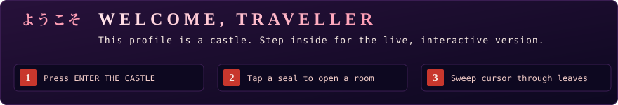
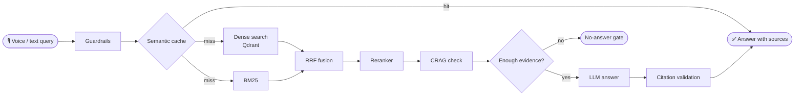
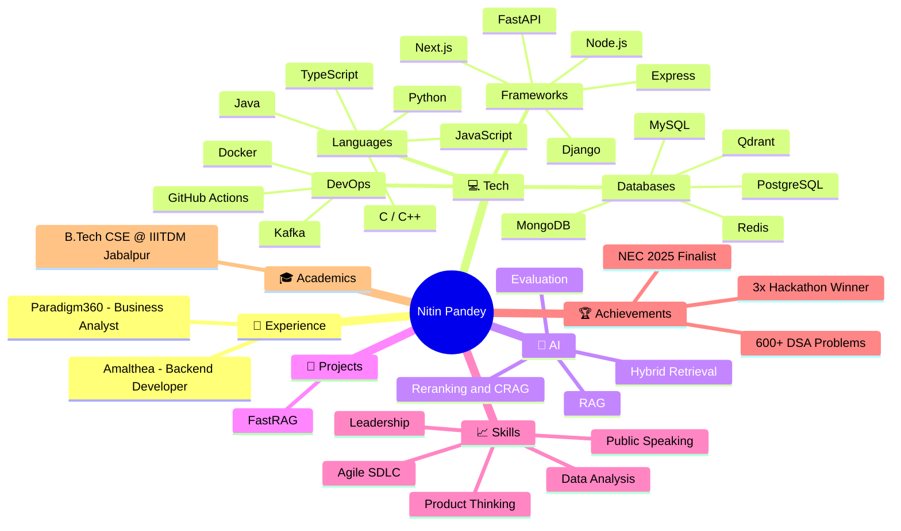

<a id="top"></a>

<div align="center">



<a href="https://nitin192005.github.io/Nitin192005/">
  
</a>

<br/>

<a href="https://nitin192005.github.io/Nitin192005/#about"></a><a href="https://nitin192005.github.io/Nitin192005/#projects"></a><a href="https://nitin192005.github.io/Nitin192005/#experience"></a><a href="https://nitin192005.github.io/Nitin192005/#achievements"></a><a href="https://nitin192005.github.io/Nitin192005/#contact"></a>

<br/>

<sub><b>On this page:</b> <a href="#about">About</a> · <a href="#tech">Tech</a> · <a href="#projects">Projects</a> · <a href="#experience">Experience</a> · <a href="#achievements">Achievements</a> · <a href="#activity">Activity</a> · <a href="#journey">Journey</a> · <a href="#contact">Contact</a></sub><br/>
<sub>Tip: every floor below is collapsible. Click a banner to open or close it.</sub>

<br/>


<a href="https://git.io/typing-svg">
  
</a>

<br/>

<a href="https://linkedin.com/in/nitin-pandey-dev"></a>
<a href="mailto:nitin2005@gmail.com"></a>
<a href="https://github.com/Nitin192005"></a>

</div>

<br/>

<!-- ═══════════════ FLOORS: click a header to open / close ═══════════════ -->

<a id="about"></a>
<details open>
<summary></summary>
<br/>

```yaml
name:        Nitin Pandey
education:   B.Tech CSE @ IIITDM Jabalpur (2023–2027), CGPA 8.0
focus:       Backend engineering · AI systems
building:    FastRAG, hybrid retrieval, reranking, RAG evaluation
reach_me:    nitin2005@gmail.com
```

> I like building things at the intersection of **AI, backend systems and business strategy**, and shipping what real users touch.

<div align="right"><sub><a href="#top">↑ Back to top</a></sub></div>

</details>

<a id="tech"></a>
<details open>
<summary></summary>
<br/>

<div align="center">

<br/>
<br/>
<br/>


</div>

<details>
<summary><b>🤖 AI / LLM toolkit (click to expand)</b></summary>
<br/>

<div align="center">


-0D0820?style=flat-square&logoColor=FF9EB5)


</div>

</details>

<div align="right"><sub><a href="#top">↑ Back to top</a></sub></div>

</details>

<a id="projects"></a>
<details open>
<summary></summary>
<br/>

<div align="center">

### 🔎 [FastRAG](https://github.com/Nitin192005/FastRag)
Voice-enabled, multilingual, source-grounded RAG service.

- Voice-enabled multilingual question answering with dense and BM25 retrieval
- Reciprocal rank fusion, cross-encoder reranking, and corrective RAG
- Guardrails, citation validation, no-answer gating, and caching
- Golden-dataset evaluation with retrieval and faithfulness metrics
- Langfuse tracing and Docker-based deployment


<details>
<summary><b>🧠 How a FastRAG query flows (click to expand)</b></summary>
<br/>



<sub>Simplified view of the retrieval pipeline.</sub>

</details>

<div align="right"><sub><a href="#top">↑ Back to top</a></sub></div>

</details>

<a id="experience"></a>
<details open>
<summary></summary>
<br/>

<details>
<summary><b>🛠️ Backend Developer Intern · Amalthea Consultancy</b> &nbsp;<i>(Jan – Mar 2025)</i></summary>
<br/>

- Built and maintained **25+ REST APIs** (Python, Django, PostgreSQL) for a platform serving **2,500+ farmers**
- Managed **5GB+** of application data on PostgreSQL and AWS
- Deployed on **AWS EC2 and S3**, integrated Firebase notifications with **98% delivery success**
- Optimized queries and storage: **45% faster**, **30% less storage**, **99.8% uptime**

</details>

<details>
<summary><b>📊 Business Analyst Intern · Paradigm360 Pte Ltd, Singapore</b> &nbsp;<i>(Apr – May 2025)</i></summary>
<br/>

- Analyzed **5,000+ records** with SQL to find **4+ product gaps** and conversion bottlenecks
- Defined **7+ product requirements** and ranking logic for the MVP
- Supported changes tied to a **27% rise in buyer-supplier conversion** and a **34% drop in onboarding drop-off**
- Built Power BI and Google Sheets dashboards to track KPIs

</details>

<div align="right"><sub><a href="#top">↑ Back to top</a></sub></div>

</details>

<a id="achievements"></a>
<details>
<summary></summary>
<br/>

<div align="center">

| 🥇 | 🎯 | 🇮🇳 | 🧩 |
|:---:|:---:|:---:|:---:|
| **Three-time hackathon winner** | **NEC 2025 finalist**<br/>IIT Bombay | **National-level innovation recognition**<br/>Assistive device | **600+ DSA problems solved** |

</div>

<details>
<summary><b>🤝 Leadership & Volunteering</b></summary>
<br/>

- Startup Coordinator at IIC · PR Lead at E-Cell
- Coordinated **25+ workshops** involving **400+ students**
- Helped secure **₹6 lakh+ in sponsorships**

</details>

<div align="right"><sub><a href="#top">↑ Back to top</a></sub></div>

</details>

<a id="activity"></a>
<details>
<summary></summary>
<br/>

<div align="center">

<h3>🐍 Contribution Snake</h3>

<picture>
  <source media="(prefers-color-scheme: dark)" srcset="https://raw.githubusercontent.com/Nitin192005/Nitin192005/output/github-snake-dark.svg" />
  <source media="(prefers-color-scheme: light)" srcset="https://raw.githubusercontent.com/Nitin192005/Nitin192005/output/github-snake.svg" />
  
</picture>

</div>

<div align="right"><sub><a href="#top">↑ Back to top</a></sub></div>

</details>

<a id="journey"></a>
<details>
<summary></summary>
<br/>



<div align="right"><sub><a href="#top">↑ Back to top</a></sub></div>

</details>

<br/>

<a id="contact"></a>
<div align="center">

<h2>📬 Let's build something together</h2>

<a href="mailto:nitin2005@gmail.com"></a>

<i>⭐ If you like what you see, drop a star on a repo!</i>

<br/><br/>


</div>
